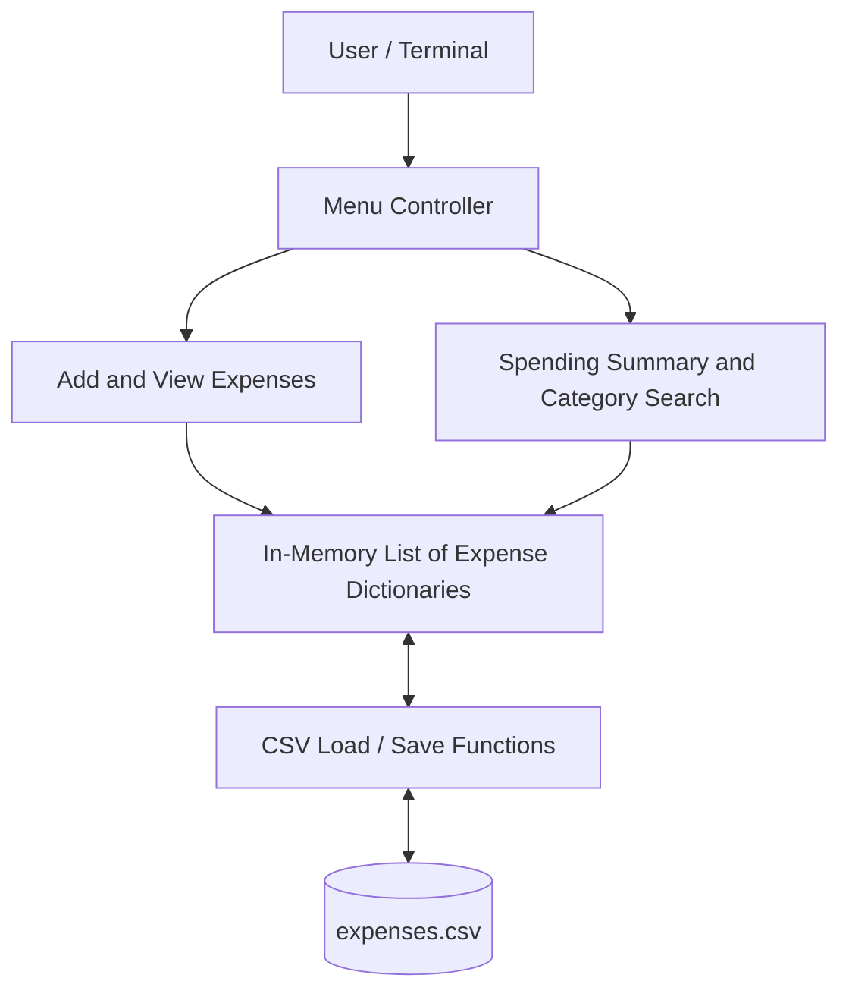
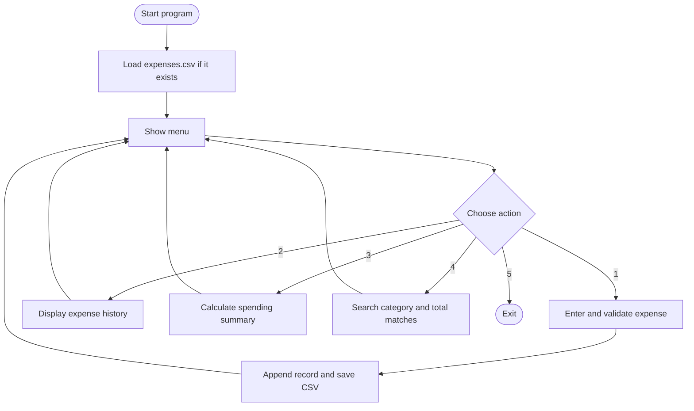

💰 Python Smart Expense Tracker
   
A lightweight, command-line expense management application built with Python. Record everyday spending, review expenses, calculate category totals, and keep data between sessions using local CSV storage.
Project focus: Python fundamentals, reliable file handling, data validation, and accurate financial calculations.

📑 Contents
- Overview
- Key Features
- Screenshots
- Technical Architecture
- Application Workflow
- Technology Stack
- Getting Started
- Data Structure
- Implementation Highlights
- Project Structure
- What I Learned
- Future Improvements
- Author
📌 Overview
The Python Smart Expense Tracker is a menu-driven application that helps users manage and analyse daily spending without an account, database server, or third-party service. Users can add dated expense records, browse history, view spending summaries, and search for expenses in a category.

Expense records are stored locally in expenses.csv and loaded automatically when the application starts. The program uses Python's Decimal type for money calculations and validates input before saving.
✨ Key Features
Feature	Description
➕ Add expenses	Record date, description, category, and amount in Singapore dollars
📋 View history	Display saved expense records in a numbered list
📊 Spending summary	Calculate total expense count, total spending, totals by category, and the highest-spending category
🔎 Category search	Find expenses by category and calculate the matching total
💾 Persistent storage	Save to expenses.csv and load saved records at startup
🛡️ Validation	Check dates, required text, positive finite amounts, and at most two decimal places
🔁 Safer file writing	Write a temporary CSV file before replacing the previous file

📸 Screenshots
Screenshots to add: Run the application and save real terminal screenshots using the filenames below. Until those files are uploaded, the image links will not render.

Main menu

Adding an expense

Spending summary

Search by category

Tip: Use sample expenses rather than personal financial information in public screenshots.
🏗️ Technical Architecture

Main components
Component	Python function(s)	Responsibility
Startup and navigation	main(), show_menu()	Load existing data and process menu choices
Expense entry	add_expense()	Validate and append a new expense, then save it
Expense history	view_expenses()	Display recorded expenses
Spending analysis	spending_summary()	Compute total and category-level spending
Category lookup	search_by_category()	Filter matching expenses and total their amounts
Data persistence	load_expenses(), save_expenses()	Read, validate, and write CSV data

🔄 Application Workflow

Save workflow: A valid new expense is added to the in-memory list. The program writes all records to a temporary CSV file, then uses os.replace() to replace the existing file. If saving raises an OSError, the newly added record is removed from the in-memory list and an error is shown.

Load workflow: At startup, the program reads the CSV header, checks the required columns, validates dates and amounts, and loads valid records. A missing CSV is treated as a first run. Invalid saved data stops startup with an error rather than silently continuing with incomplete records.
🧰 Technology Stack
Technology	Role
Python 3	Application logic and terminal interface
csv	Structured CSV reading and writing
decimal.Decimal	Accurate base-10 financial arithmetic
datetime.date	Date validation and today's default date
tempfile and os	Temporary-file saving and replacement
Lists and dictionaries	In-memory expense records and category totals

Dependencies: Python standard library only; no pip install required.
🚀 Getting Started
Prerequisites
- Python 3 installed
- A terminal (Command Prompt, PowerShell, macOS Terminal, etc.)
Installation
git clone https://github.com/Hulk-Dexteen/python-smart-expense-tracker.git
cd python-smart-expense-tracker
Alternatively, download the repository as a ZIP file and extract it.
Run
python expensetracker1.py
On some systems, use python3 expensetracker1.py instead.
Menu
=== SMART EXPENSE TRACKER ===
1. Add expense
2. View expenses
3. View spending summary
4. Search by category
5. Exit
Enter a number from 1 to 5 and follow the prompts. The CSV file is created when you save your first expense. It is stored relative to the working directory from which you run the program.
🗂️ Data Structure
Each expense contains four fields:
Field	Example	Description
date	2026-10-27	ISO-format expense date
description	Lunch	Expense description
category	Food	Spending category
amount	8.50	Positive amount, stored as Decimal in Python

Example CSV content (illustrative sample data):
date,description,category,amount
2026-10-27,Lunch,Food,8.50
2026-10-27,Bus fare,Transport,2.00
🔍 Implementation Highlights
Accurate money handling
Decimal avoids the binary floating-point representation issues that can affect currency arithmetic. The application accepts amounts with no more than two decimal places and formats output in Singapore dollars.
Input validation
The program checks date format, non-empty descriptions and categories, and valid positive amounts. Invalid input is rejected with a message instead of being saved.
Safer CSV updates
Rather than overwriting the CSV directly, the program writes to a temporary file in the same directory and then replaces the original file. This reduces the risk of leaving a partially written CSV during a failed write, although it is not a substitute for backups.
Category analytics
The summary groups expense amounts by category, calculates the overall total, and identifies the category with the highest spending. Category search is case-insensitive.
📁 Project Structure
python-smart-expense-tracker/
├── expensetracker1.py       # Main Python application
├── README.md                # Project documentation
├── .gitignore               # Git exclusions
└── screenshots/             # Add real screenshots here
    ├── main-menu.png
    ├── add-expense.png
    ├── spending-summary.png
    └── category-search.png
Local data: expenses.csv is generated when expenses are saved. Avoid committing real personal financial records to a public repository.
🎓 What I Learned
Building this project helped me practise:
- Structuring a Python program with reusable functions
- Using lists, dictionaries, loops, and conditional statements
- Reading and writing CSV files with DictReader and DictWriter
- Handling invalid input and file errors with exceptions
- Using Decimal for financial calculations
- Designing a simple interactive command-line application
- Publishing and documenting a project on GitHub
🛣️ Future Improvements
These are planned ideas, not current features:
- Monthly spending reports and date filters
- Budget targets and alerts
- Charts and spending visualisations
- Edit and delete expense records
- Automated tests
- A graphical or web-based interface
👨‍💻 Author
Dexteen — Hulk-Dexteen

Created as a hands-on Python learning project and part of my software development portfolio.
